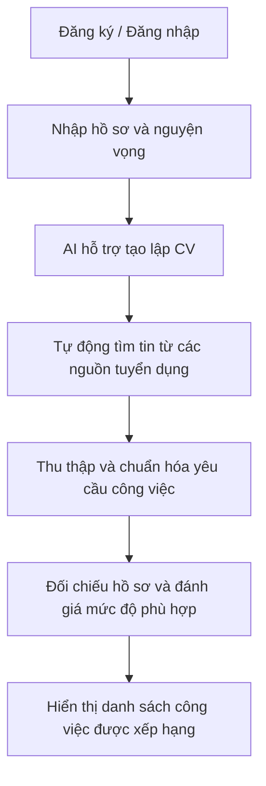

# AI CV Recruitment

### Hệ thống AI hỗ trợ tạo lập hồ sơ ứng viên, tự động tìm kiếm và đánh giá mức độ phù hợp với vị trí tuyển dụng

Repository mã nguồn và tài liệu thiết kế phục vụ đồ án tốt nghiệp, được phát triển theo kế hoạch **9 tuần**.

**Giai đoạn hiện tại:** Tuần 1 — Phân tích yêu cầu, thiết kế hệ thống và xây dựng nguyên mẫu giao diện.

[ Tài liệu phân tích và thiết kế ](docs/week-1.md) · [ Thiết kế cơ sở dữ liệu ](database/schema.sql) · [ Mốc bàn giao tuần 1 ](https://github.com/Thaiabcc/ai-cv-recruitment/tree/week-1)

## 1. Giới thiệu đề tài

Đề tài hướng đến việc hỗ trợ ứng viên xây dựng hồ sơ và tìm kiếm công việc phù hợp từ các nguồn tuyển dụng được cấu hình sẵn. Hệ thống sử dụng thông tin về học vấn, kỹ năng, kinh nghiệm, dự án và nguyện vọng của ứng viên để hỗ trợ tạo CV, tìm kiếm tin tuyển dụng và đối chiếu với yêu cầu của từng vị trí.

Kết quả được trình bày dưới dạng danh sách công việc xếp theo mức độ phù hợp, kèm liên kết tin tuyển dụng, các yêu cầu đã đáp ứng, các yêu cầu còn thiếu hoặc chưa đủ thông tin, giải thích đánh giá và gợi ý cải thiện.

## 2. Quy trình nghiệp vụ



Người dùng nhập thông tin hồ sơ; hệ thống chủ động tìm kiếm công việc từ danh sách nguồn đã cấu hình. Người dùng có thể chỉnh sửa hồ sơ và xem lại lịch sử kết quả.

## 3. Phạm vi chức năng

| Nhóm chức năng | Nội dung dự kiến |
| :--- | :--- |
| Quản lý tài khoản | Đăng ký, đăng nhập, đăng xuất và kiểm soát quyền truy cập dữ liệu |
| Quản lý hồ sơ | Nhập, lưu và chỉnh sửa thông tin cá nhân, học vấn, kỹ năng, kinh nghiệm, dự án và nguyện vọng |
| Tạo lập CV | AI hỗ trợ biên soạn nội dung, lưu phiên bản và xuất PDF/DOCX |
| Tìm kiếm việc làm | Tự động tìm tin tuyển dụng từ các nguồn được cấu hình sẵn dựa trên hồ sơ |
| Đánh giá mức độ phù hợp | Đối chiếu hồ sơ với yêu cầu công việc và giải thích kết quả |
| Hiển thị kết quả | Xếp hạng công việc, cung cấp link tin gốc, điểm đáp ứng, điểm còn thiếu và gợi ý cải thiện |
| Lịch sử | Lưu và xem lại các lượt tìm kiếm, đánh giá |

TopCV là nguồn dự kiến khảo sát đầu tiên. Danh sách nguồn tích hợp chính thức được xác định sau khi kiểm tra khả năng và điều kiện truy cập dữ liệu.

## 4. Kết quả thực hiện tuần 1

| Hạng mục | Kết quả |
| :--- | :--- |
| Phân tích yêu cầu | Xác định mục tiêu, phạm vi, tác nhân và luồng nghiệp vụ chính |
| Thiết kế hệ thống | Đề xuất kiến trúc, quy trình xử lý và phương án đánh giá |
| Thiết kế dữ liệu | Xây dựng mô hình và script SQL cho tài khoản, hồ sơ, CV, nguồn tuyển dụng, tin tuyển dụng và kết quả |
| Khởi tạo ứng dụng | Thiết lập FastAPI, cấu hình môi trường và cấu trúc mã nguồn |
| Nguyên mẫu giao diện | Màn hình nhập hồ sơ và danh sách kết quả đánh giá minh họa |
| Kiểm tra hoạt động | Chạy ứng dụng, kiểm tra API và thao tác nhập hồ sơ, hiển thị kết quả trên trình duyệt |

### Giới hạn của phiên bản hiện tại

Phiên bản tuần 1 phục vụ kiểm tra cấu trúc và luồng giao diện. Công việc và điểm đánh giá sử dụng dữ liệu mẫu cố định; thông tin nhập chưa được lưu. Các chức năng xác thực tài khoản, tạo CV bằng AI, thu thập tin tuyển dụng thực tế và xuất tài liệu được triển khai ở các giai đoạn tiếp theo.

Script SQL hiện là bản thiết kế khởi tạo, chưa được kiểm chứng trên MySQL thực tế. API kiểm tra hoạt động chỉ xác nhận ứng dụng đang chạy.

## 5. Công nghệ sử dụng

| Thành phần | Công nghệ |
| :--- | :--- |
| Ngôn ngữ và backend | Python, FastAPI |
| Giao diện | HTML, CSS, JavaScript |
| Cơ sở dữ liệu | MySQL, SQLAlchemy, PyMySQL |
| AI dự kiến tích hợp | Google Gemini API |
| Xử lý và thu thập dữ liệu dự kiến | Pandas, web scraping |
| Định dạng tài liệu đầu ra | PDF, DOCX |
| Công cụ phát triển | VS Code, Git/GitHub, Postman |

## 6. Cấu trúc repository

```text
ai-cv-recruitment/
├── app/
│   ├── config.py           # Cấu hình môi trường
│   ├── database.py         # Thiết lập kết nối MySQL
│   └── main.py             # Ứng dụng và API
├── database/
│   └── schema.sql          # Thiết kế cơ sở dữ liệu
├── docs/
│   └── week-1.md           # Phân tích yêu cầu và thiết kế tuần 1
├── static/
│   ├── index.html          # Nguyên mẫu giao diện
│   ├── styles.css          # Định dạng giao diện
│   └── app.js              # Tương tác giao diện
├── .env.example            # Cấu hình mẫu
├── requirements.txt        # Thư viện Python
├── run.bat                 # Khởi động trên Windows
└── README.md
```

## 7. Hướng dẫn cài đặt và chạy

### Yêu cầu môi trường

- Python 3.11 trở lên.
- Git để tải mã nguồn.
- Windows để sử dụng `run.bat`.

Bản nguyên mẫu tuần 1 có thể chạy mà chưa cần cài MySQL hoặc cung cấp khóa Gemini.

### Tải mã nguồn

```powershell
git clone https://github.com/Thaiabcc/ai-cv-recruitment.git
cd ai-cv-recruitment
```

Repository riêng tư yêu cầu tài khoản đã được cấp quyền truy cập.

### Cài đặt lần đầu

```powershell
python -m venv .venv
.\.venv\Scripts\python.exe -m pip install -r requirements.txt
Copy-Item .env.example .env
```

### Khởi động

```powershell
.\run.bat
```

| Nội dung | Địa chỉ |
| :--- | :--- |
| Giao diện ứng dụng | http://127.0.0.1:8000 |
| Tài liệu và thử API | http://127.0.0.1:8000/docs |
| Kiểm tra hoạt động | http://127.0.0.1:8000/api/health |

Dừng ứng dụng bằng **Ctrl + C**. Nếu cổng 8000 đang được sử dụng, chạy `.\run.bat --port 8001` và truy cập http://127.0.0.1:8001.

### Cấu hình cho các giai đoạn tiếp theo

Thông số MySQL và khóa Gemini được đặt trong `.env` theo mẫu `.env.example`. Script `database/schema.sql` dành cho database phát triển mới và không được ứng dụng tự thực thi. Các bước kết nối dịch vụ thực tế sẽ được cập nhật khi triển khai.

File `.env`, mật khẩu, khóa API và hồ sơ ứng viên thực tế không được đưa vào repository.

## 8. Kế hoạch thực hiện

| Tuần | Nội dung |
| :---: | :--- |
| 1 | Phân tích yêu cầu, thiết kế dữ liệu, kiến trúc và nguyên mẫu giao diện |
| 2 | Xác thực tài khoản, kiểm soát quyền truy cập và lưu hồ sơ MySQL |
| 3 | Tích hợp Gemini hỗ trợ tạo và chỉnh sửa CV, lưu phiên bản |
| 4 | Khảo sát và tích hợp nguồn tuyển dụng, tìm tin theo hồ sơ |
| 5 | Chuẩn hóa dữ liệu, loại trùng và xử lý tác vụ nền, lỗi nguồn |
| 6 | Đối chiếu yêu cầu, đánh giá, giải thích, xếp hạng và lịch sử |
| 7 | Xuất PDF/DOCX và hoàn thiện quy trình tự động |
| 8 | Kiểm thử tích hợp, đánh giá chất lượng và hoàn thiện giao diện |
| 9 | Hoàn thiện báo cáo, demo và chuẩn bị bảo vệ |

## 9. Tài liệu và phiên bản

- [Phân tích yêu cầu và thiết kế tuần 1](docs/week-1.md).
- [Script thiết kế cơ sở dữ liệu](database/schema.sql).
- [Phiên bản mã nguồn tại mốc tuần 1](https://github.com/Thaiabcc/ai-cv-recruitment/tree/week-1).

Nhánh `main` chứa các cập nhật mới nhất. Tag `week-1` giữ nguyên mã nguồn tại thời điểm bàn giao tuần 1.
