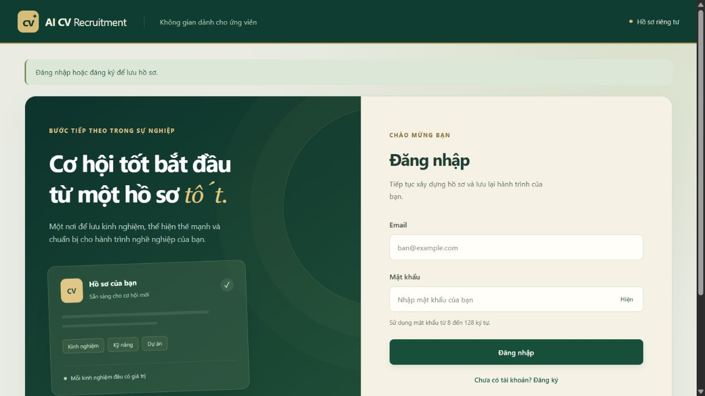
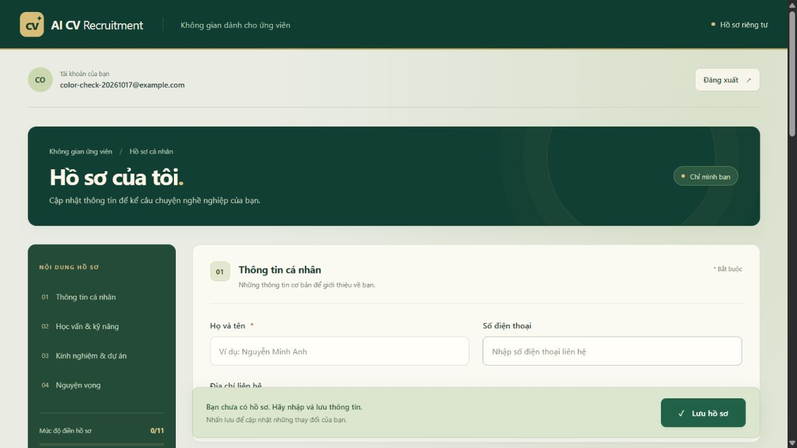

# Tuần 2 — Tài khoản và hồ sơ ứng viên

## Thiết kế

- Mật khẩu được băm Argon2id, không lưu mật khẩu gốc; email chuẩn hóa chữ thường và có ràng buộc duy nhất trong MySQL.
- Cookie `cv_session` là mã ngẫu nhiên 256 bit, HttpOnly, SameSite=Strict. Database chỉ lưu SHA-256 của mã phiên cùng chủ tài khoản và hạn dùng UTC.
- Đăng nhập tạo mã phiên mới; đăng xuất xóa phiên ở database để cookie cũ không thể dùng lại. Phiên hết hạn bị từ chối và dọn khi tạo phiên mới.
- Các API riêng tư trả `Cache-Control: no-store`. Yêu cầu thay đổi dữ liệu cần header riêng và kiểm tra Origin; không bật CORS.
- Hồ sơ lấy chủ sở hữu từ phiên đăng nhập, không nhận ID người dùng từ client. GET trả hồ sơ hiện tại hoặc null; PUT tạo/cập nhật toàn bộ hồ sơ.
- Dùng các cột JSON sẵn có: contact và preferences là object; education, skills, experience, projects là chuỗi JSON theo biểu mẫu văn bản hiện tại. Các mảng có cấu trúc có thể được bổ sung ở giai đoạn CV.
- Migration tuần 2 chỉ thêm bảng `auth_sessions`, không xóa hoặc sửa dữ liệu tuần 1.

## Kết quả kiểm thử tự động

Ngày 17/10/2026: **7/7 ca qua trên SQLite và 7/7 ca qua trên MySQL 8.4.9**.

1. Đăng ký: Argon2 xác minh được mật khẩu; response không chứa mật khẩu; cookie HttpOnly/Strict; database chỉ lưu hash phiên.
2. Trùng email trả 409; email và mật khẩu sai định dạng trả 422.
3. Đăng nhập sai mật khẩu trả 401; đăng nhập đúng thành công; đăng xuất vô hiệu hóa cả cookie cũ.
4. Chưa đăng nhập không được xem/lưu hồ sơ hay xem demo; thiếu header hoặc Origin khác nguồn trả 403.
5. Lưu đủ các trường tiếng Việt, đọc lại, đăng xuất/đăng nhập lại vẫn còn; sửa hồ sơ thành công; hai tài khoản có dữ liệu riêng; gửi user_id bị từ chối.
6. Phiên hết hạn hoặc mã phiên giả trả 401.
7. Tên trống hoặc dữ liệu quá dài trả 422; response hồ sơ không lưu cache.

Kiểm thử MySQL dùng rollback giao dịch, không để lại dữ liệu thử. Kiểm tra cú pháp JavaScript và biên dịch Python đã qua. Đã kiểm thử trên trình duyệt: đăng ký, lưu hồ sơ, tải lại trang, đăng xuất và đăng nhập lại; hồ sơ được khôi phục đúng từ MySQL. Ảnh minh chứng: `week-2-profile.png`. Các bước kiểm tra thủ công được trình bày trong phần tiếp theo.

## Nghiệm thu giao diện

- Đăng ký tài khoản A; nhập đầy đủ hồ sơ; lưu rồi tải lại trang để kiểm tra các trường.
- Chỉnh sửa một số thông tin, lưu và đăng nhập lại để đối chiếu.
- Đăng xuất, đảm bảo form hồ sơ và kết quả được ẩn, dữ liệu trên màn hình được xóa.
- Đăng ký tài khoản B, đảm bảo không có hồ sơ A; lưu hồ sơ B rồi quay lại A để kiểm tra tách biệt.
- Kiểm tra thông báo khi email trùng, mật khẩu sai, server/database không hoạt động.

## Phạm vi còn lại

Giai đoạn này tập trung vào tài khoản và hồ sơ; xác minh email, khôi phục mật khẩu và giới hạn thử đăng nhập chưa nằm trong phạm vi triển khai. Chức năng CV, tìm việc và đánh giá được trình bày trong tài liệu các giai đoạn tiếp theo.

## Kết quả triển khai

Chức năng tài khoản và hồ sơ được lưu tại mốc phiên bản `week-2`.

Giao diện chia hồ sơ thành bốn nhóm, có điều hướng nhanh, tiến độ điền, trạng thái chưa lưu và nút hiện/ẩn mật khẩu. Phối màu xanh rừng, ngà ấm và vàng đồng. Minh họa giao diện:

Ứng dụng dùng MySQL để lưu dữ liệu thật. SQLite chỉ dùng trong bộ kiểm thử độc lập, không phải database chạy ứng dụng.
