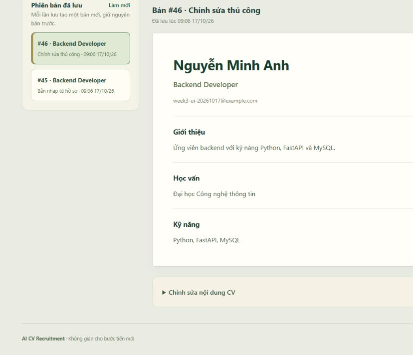
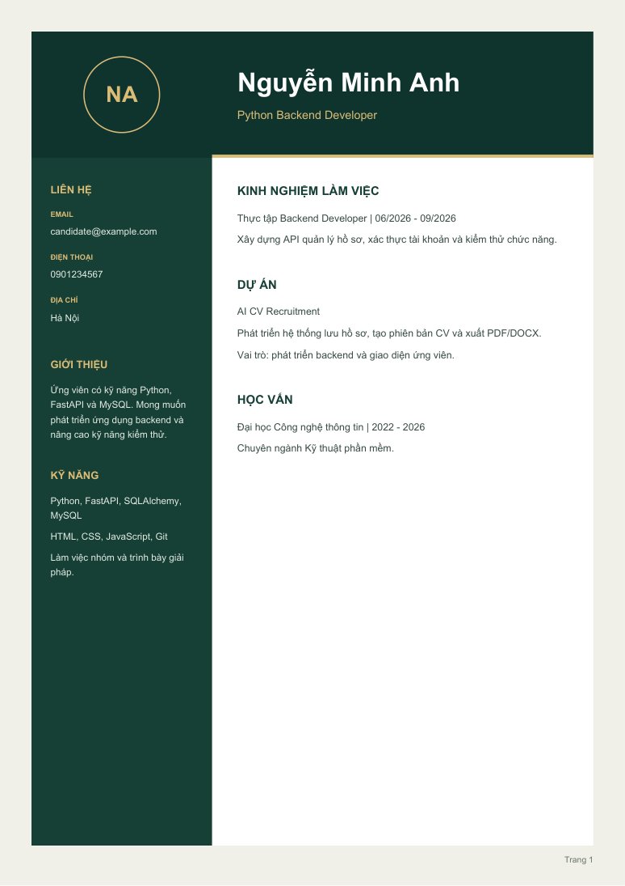
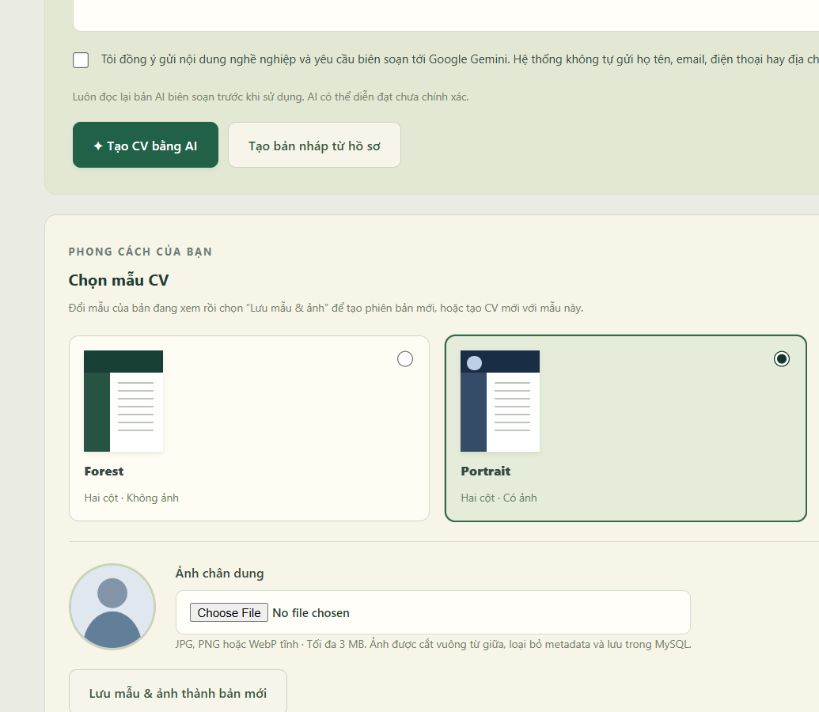
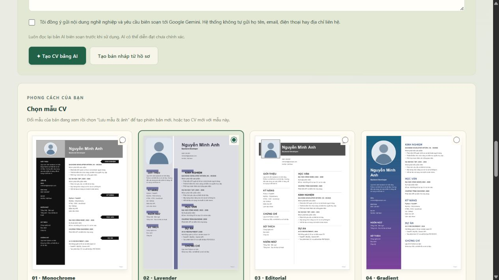
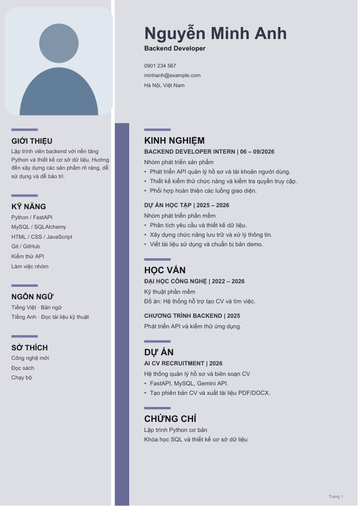

# Tuần 3 — CV, Gemini và xuất tài liệu

## Trạng thái

Đã triển khai API và giao diện tạo CV, chỉnh sửa, lưu phiên bản và xuất PDF/DOCX. Chưa chốt hoàn thành tuần 3: đã đọc được khóa Gemini; gọi dịch vụ thật còn gặp Google 503 quá tải. Còn kiểm tra bố cục DOCX bằng Word/LibreOffice.

## Chức năng

- Tạo bản nháp từ hồ sơ đã lưu, không gọi AI; dùng được ngay khi chưa có khóa Gemini.
- Nhờ Gemini biên soạn CV tiếng Việt hoặc chỉnh sửa phiên bản đã chọn theo yêu cầu.
- Xem trước nội dung, chỉnh sửa thủ công và lưu thành phiên bản mới; không ghi đè phiên bản cũ.
- Lịch sử theo từng tài khoản, 30 bản mỗi trang; chọn và tải lại bản cũ.
- PDF A4 với font Unicode, số trang, tự ngắt trang; DOCX có thể chỉnh sửa bằng Word.
- Bản tải xuống được tạo trong bộ nhớ từ đúng phiên bản đang chọn, không để file CV riêng tư trong static.
- Mỗi thao tác đọc/chỉnh sửa/xuất CV kiểm tra chủ tài khoản; ID không thuộc tài khoản trả 404.

## Cấu hình Gemini

Điền trong `.env` trên máy, không gửi khóa lên GitHub:

```dotenv
GEMINI_API_KEY=your_api_key_here
GEMINI_MODEL=gemini-3.8-flash
```

Khởi động lại `run.bat` sau khi đổi cấu hình. Tên mô hình có thể thay theo quyền truy cập của dự án Google. Model mặc định và giao thức Structured Output được đối chiếu tài liệu Google ngày 17/10/2026:

- [Structured outputs và REST generateContent](https://ai.google.dev/gemini-api/docs/generate-content/structured-output?hl=en)
- [Lưu ý quyền truy cập các mô hình 2.5 với dự án mới](https://ai.google.dev/gemini-api/docs/models/gemini-2.5-flash)

Giao diện yêu cầu đồng ý trước khi gửi nội dung nghề nghiệp và yêu cầu biên soạn tới Google. Ứng dụng không tự gửi các trường tên, email, điện thoại, địa chỉ; nếu người dùng tự nhập thông tin này trong kinh nghiệm hay yêu cầu thì nó vẫn thuộc văn bản gửi đi.

AI chỉ biên tập dữ kiện, không được bịa thành tích; đầu ra phải đúng schema và giới hạn độ dài. Người dùng vẫn cần kiểm tra tính chính xác trước khi dùng. Không sử dụng tool, URL hoặc HTML từ đầu ra mô hình. Khóa chỉ nằm ở server, truyền qua header; lỗi dịch vụ được chuyển thành thông báo chung, không trả lỗi thô chứa khóa.

Thiếu khóa hoặc mô hình chưa khả dụng trả 503; hết hạn mức trả 429; mất kết nối/đầu ra sai trả 502; timeout trả 504. Không tạo bản CV mới khi gọi AI thất bại. Không tự động gọi lại để tránh nhân đôi chi phí.

## Dữ liệu và API

Dùng bảng `cvs` đã có từ tuần 1, không cần migration mới. Mỗi dòng là một phiên bản độc lập: `profile_snapshot` giữ hồ sơ nguồn; `content` chứa `schema_version`, `document`, `origin`, `parent_id`, `model`. Các bản chỉnh sửa tiếp tục giữ snapshot của bản gốc; chỉnh sửa hồ sơ sau đó không làm thay đổi CV đã lưu. Muốn dùng hồ sơ mới, tạo CV mới từ hồ sơ.

| Phương thức | Đường dẫn | Chức năng |
| --- | --- | --- |
| GET | `/api/cvs/status` | Trạng thái cấu hình AI, không trả khóa |
| GET | `/api/cvs?before_id=...` | Lịch sử của tài khoản |
| POST | `/api/cvs/draft` | Bản nháp từ hồ sơ |
| POST | `/api/cvs/generate` | AI biên soạn, nhận instructions và consent |
| GET | `/api/cvs/{id}` | Nội dung phiên bản |
| POST | `/api/cvs/{id}/versions` | Lưu bản chỉnh sửa thủ công |
| POST | `/api/cvs/{id}/revise` | AI chỉnh sửa bản đã lưu |
| GET | `/api/cvs/{id}/export/pdf` | Tải PDF |
| GET | `/api/cvs/{id}/export/docx` | Tải DOCX |

Toàn bộ API yêu cầu cookie phiên; thao tác thay đổi dữ liệu cần header `X-Requested-With: cv-app`. Phiên bản, nội dung xem trước và tải xuống đều không lưu cache. Giao diện yêu cầu lưu/bỏ thay đổi CV trước khi chọn bản khác hoặc xuất tài liệu để tránh tải nhầm bản cũ.

## Cài đặt và nghiệm thu

```powershell
.\.venv\Scripts\python.exe -m pip install -r requirements-dev.txt
.\run.bat
```

1. Đăng nhập, lưu hồ sơ, chọn **CV của tôi**.
2. Tạo bản nháp; mở phần chỉnh sửa, sửa nội dung rồi lưu phiên bản mới.
3. Tải lại trang, chọn lại từng phiên bản; kiểm tra bản cũ giữ nguyên.
4. Tải PDF và DOCX, kiểm tra tiếng Việt và dữ liệu đúng với phiên bản.
5. Sau khi điền khóa Gemini, chọn đồng ý gửi dữ liệu, tạo CV bằng AI rồi yêu cầu AI chỉnh sửa.
6. Dùng tài khoản khác để xác nhận không đọc hoặc tải được CV của tài khoản trước.

Windows tự nhận font Arial. Linux cần DejaVu Sans. Có thể chỉ định TTF bằng `CV_FONT_PATH` và `CV_FONT_BOLD_PATH`. Nếu thiếu font Unicode, API PDF báo lỗi cấu hình thay vì xuất file lỗi chữ. DOCX dùng Arial, phần mềm mở file có thể thay font nếu chưa cài.

## Kiểm thử ngày 17/10/2026

- 19/19 ca qua trên SQLite và 19/19 ca qua trên MySQL 8.4.9, bao gồm 7 ca tài khoản tuần 2.
- 12 ca tuần 3 bao phủ bản nháp, sửa và giữ phiên bản cũ, snapshot, quyền giữa tài khoản, CSRF, phân trang, thiếu khóa, gọi AI, lỗi/quota/timeout/đầu ra sai và xuất PDF/DOCX tiếng Việt.
- Các phản hồi Gemini trong bộ kiểm thử được mô phỏng. Đã gọi dịch vụ thật bằng hồ sơ giả sau khi người dùng thêm khóa: sửa cấu hình structured output sang responseMimeType/responseJsonSchema; sau đó Google trả 503 do quá tải. Chưa xác nhận một lần sinh CV AI thành công.
- Trình duyệt đã xác nhận tạo bản nháp, sửa/lưu bản mới, tải lại lịch sử và chọn lại bản cũ.
- PDF mẫu 1 trang và mẫu dài 4 trang đã được dựng thành ảnh và kiểm tra: dấu tiếng Việt đầy đủ, không tràn hay cắt chữ, có số trang.
- DOCX đã mở được bằng thư viện và kiểm tra nội dung; chưa dựng ảnh vì máy thiếu `soffice.exe` (LibreOffice). Cần kiểm tra trực quan bằng Word/LibreOffice trước chốt bàn giao.
- Dữ liệu kiểm thử tự động dùng rollback; tài khoản và CV giả thử giao diện được dọn sau kiểm tra. Server kiểm thử được tắt khi xong.



## PDF theo mẫu tham chiếu của người dùng

Đã tham khảo bốn ảnh trong `references/cv-templates/` và triển khai bố cục hai cột, phần đầu nổi bật tên/vị trí, chữ viết tắt tên trong huy hiệu tròn thay ảnh. Dùng xanh rừng, nền ngà và vàng đồng để đồng bộ giao diện.

Cột trái: liên hệ, giới thiệu, kỹ năng. Cột phải: kinh nghiệm, dự án, học vấn. Không thêm ảnh người giả, mục hồ sơ không tồn tại hay điểm kỹ năng tự suy đoán. PDF giữ nội dung dạng chữ có thể chọn/tìm kiếm, nhúng font Unicode, có số trang. Cả hai cột tự chia qua nhiều trang khi dài; kiểm thử kiểm đếm từng dòng để phát hiện mất/trùng nội dung.

DOCX tiếp tục dùng bố cục một cột có thể chỉnh sửa; màn hình xem trước hiển thị nội dung, không mô phỏng chính xác phân trang PDF.



Tài liệu cấu hình REST được đối chiếu với [GenerationConfig của Google](https://ai.google.dev/api/generate-content#v1beta.GenerationConfig).

## Template và ảnh chân dung trong MySQL

Đã triển khai ba lựa chọn, áp dụng cho cả PDF và DOCX:

- Forest: hai cột xanh rừng, không ảnh.
- Portrait: hai cột xanh navy, cần tải ảnh chân dung.
- Minimal: một cột tối giản, không ảnh.

Chạy `database/week-3-photos.sql` sau schema tuần 1 và migration tuần 2 khi cài mới. Database trên máy phát triển đã áp dụng migration này. Script chỉ thêm bảng `cv_photos`, có thể chạy lại.

Ảnh lưu trực tiếp trong cột `data MEDIUMBLOB`, gắn với `user_id`; không lưu đường dẫn file trên máy người dùng. API nhận tối đa 3 MB, giải mã và kiểm tra JPEG/PNG/WebP tĩnh, tối thiểu 64 px, tối đa 16 triệu pixel; áp dụng hướng EXIF, cắt vuông từ giữa, đưa về 720×720 và mã hóa lại JPEG để bỏ metadata. Không nhận SVG hoặc ảnh động. Cùng một ảnh chuẩn hóa trong một tài khoản được dùng lại để tránh lưu trùng.

Ảnh là tài nguyên bất biến. Mỗi phiên bản CV lưu `design: {template_id, photo_id}` trong JSON `content`. Đổi ảnh hoặc mẫu rồi lưu tạo phiên bản mới; bản cũ vẫn trỏ tới ảnh cũ. Mẫu không ảnh luôn lưu `photo_id: null`. CV trước khi có tính năng này mặc định dùng Forest để tương thích dữ liệu cũ.

Các API mới:

| Phương thức | Đường dẫn | Chức năng |
| --- | --- | --- |
| GET | `/api/cvs/templates` | Danh sách mẫu và yêu cầu ảnh |
| POST | `/api/cvs/photos` | Tải dữ liệu ảnh từ file, trả id ảnh |
| GET | `/api/cvs/photos/{id}` | Đọc ảnh của chính tài khoản, không cache |

Các yêu cầu tạo/sửa CV nhận thêm `design`. Nếu bỏ qua khi sửa, bản mới kế thừa mẫu và ảnh của bản trước. Tạo Portrait thiếu ảnh trả 422; dùng id ảnh của tài khoản khác trả 404. Ảnh chỉ được dùng để xuất tài liệu, không gửi tới Gemini.

Trên giao diện: chọn mẫu; với Portrait chọn file ảnh; tạo CV mới hoặc bấm **Lưu mẫu & ảnh thành bản mới**. Bản xem trước hiện ảnh đã chọn, file xuất dùng đúng ảnh của phiên bản đã lưu. Chuyển sang Forest/Minimal ẩn phần tải ảnh. Để thay ảnh, tải file khác và lưu bản mới.

Kiểm thử cập nhật: **21/21 ca qua trên MySQL và 21/21 trên SQLite**. Bổ sung kiểm tra byte ảnh trong database, giới hạn kích thước, loại file, chuẩn hóa ảnh, quyền giữa tài khoản, ảnh/mẫu được giữ ở bản cũ và PDF/DOCX thực sự chứa ảnh khi dùng Portrait. Đã xem PDF mẫu ngắn của cả ba kiểu và xác nhận xuất được mẫu dài 4 trang. DOCX đã kiểm tra cấu trúc và ảnh nhúng; vẫn chờ kiểm tra bố cục trực quan bằng Word/LibreOffice.

Đã kiểm tra trên trình duyệt: mẫu và ảnh được khôi phục khi đăng nhập, đổi Portrait sang Minimal rồi lưu và mở lại bản Portrait cũ vẫn có ảnh. Ảnh dùng kiểm thử là hình minh họa, không phải chân dung thật của người dùng.



## Dựng lại theo bốn ảnh tham chiếu

Phần này thay thế bộ Forest/Portrait/Minimal nguyên mẫu phía trên. Bốn mẫu PDF hiện có bố cục riêng tương ứng từng ảnh người dùng cung cấp:

1. **Monochrome** — ảnh tham chiếu 1: banner xám hai phần, ảnh tròn nhỏ, cột trái đen và nhãn tiêu đề mũi tên ở cột phải. Ảnh tùy chọn.
2. **Lavender** — ảnh tham chiếu 2: nền lavender, ảnh lớn bo góc, vạch chia cột, khối màu phía sau tiêu đề. Cần ảnh.
3. **Editorial** — ảnh tham chiếu 3: banner xám, ảnh vuông chồng lên banner, đường kẻ chia nhóm và cột. Ảnh tùy chọn.
4. **Gradient** — ảnh tham chiếu 4: cột trái chuyển xanh–tím, ảnh tròn lớn, tên ở cột trái; các nhóm nghề nghiệp ở cột phải. Cần ảnh.

Tên và tỷ lệ chữ, cách đặt ảnh, thứ tự nhóm và palette được xử lý riêng theo từng thiết kế. Bản không ảnh của Monochrome/Editorial điều chỉnh phần đầu để không để khung ảnh trống. Các id cũ vẫn được hỗ trợ: forest dùng Monochrome không ảnh, portrait dùng Gradient, minimal giữ bản một cột cũ.

Bổ sung các mục tùy chọn trong trình sửa CV: ngôn ngữ, chứng chỉ và sở thích. Không tự tạo điểm kỹ năng, bằng cấp hay kinh nghiệm để lấp mẫu.

Ảnh thumbnail trong bộ chọn mẫu được dựng từ **PDF thực tế** chứa dữ liệu minh họa. Bản xem trước cũng đi qua cùng hàm xuất PDF rồi render từng trang thành ảnh, nên thể hiện đúng kiểu chữ, ảnh chân dung, màu và ngắt trang. Endpoint `POST /api/cvs/preview` không lưu phiên bản; mặc định trả PDF, `?representation=images` trả ảnh tối đa 8 trang mỗi lượt, hỗ trợ `start_page` để xem tiếp. Cần đăng nhập, kiểm tra nguồn và quyền ảnh; toàn bộ phản hồi không cache.

Đã kiểm tra trực quan cả bốn PDF mẫu và bản nhiều trang; sửa font chữ hẹp không đủ glyph tiếng Việt. Kiểm thử cập nhật: **24/24 ca qua trên SQLite và 24/24 trên MySQL**, gồm ảnh riêng tư, cả bốn mẫu, bản xem trước, paragraph dài liên tục và ngắt cả hai cột. Trình duyệt đã hiển thị được ảnh trang PDF sau khi đổi mẫu; ảnh riêng được giữ trong database.

PDF là bản thiết kế cố định; DOCX giữ nội dung và ảnh trong bố cục Word có thể chỉnh sửa, không bảo đảm trùng pixel với PDF. DOCX vẫn cần nghiệm thu bằng Word/LibreOffice.




## Sửa chồng chữ ở Lavender

Đã tách accent tím thành thanh nhỏ phía trên tiêu đề, chừa khoảng trống cho toàn bộ dấu tiếng Việt; không còn vẽ khối tím xuyên qua phần chữ. Thumbnail Lavender đã dựng lại từ PDF mới và đổi phiên bản URL để tránh cache ảnh cũ.

Đã xem lại cả bốn mẫu ở kích thước PDF, rà trường hợp nhiều trang và kiểm tra tọa độ chữ nằm trong khổ giấy. Thêm regression test đo giao nhau giữa khối tím và bounding box tám tiêu đề tiếng Việt. Bộ kiểm thử độc lập: 25/25 ca qua.



## Rà soát cuối ngày 17/10/2026

- Sửa nút **Bỏ ảnh khỏi bản đang chỉnh**: xóa ảnh khỏi thiết kế tạm, cập nhật xem trước và đánh dấu chưa lưu; ẩn nút khi không có ảnh. Phiên bản đã lưu và dữ liệu ảnh cũ được giữ nguyên. Lavender/Gradient vẫn yêu cầu ảnh khi lưu.
- 25/25 kiểm thử qua trên MySQL và 25/25 trên SQLite; kiểm tra JavaScript cho thao tác bỏ ảnh cũng qua. Kiểm tra cú pháp JavaScript và whitespace không có lỗi.
- Rà 16 trang PDF của bốn mẫu với dữ liệu ngắn/dài: không có chữ vượt khổ giấy trong các trường hợp đã kiểm tra; regression test tiêu đề Lavender qua.
- Thử Gemini bằng dữ liệu giả: Google trả HTTP 503 vì mô hình quá tải. Chưa nghiệm thu được một lần tạo CV AI thực tế thành công; các nhánh xử lý thành công/lỗi đã có kiểm thử mô phỏng.
- DOCX đã kiểm tra cấu trúc, nội dung và ảnh nhúng; còn nghiệm thu trực quan bằng Word/LibreOffice. PDF là định dạng đã rà bố cục.
- Đợt rà này không mở server HTTP kiểm thử; không để lại cổng server mới.
