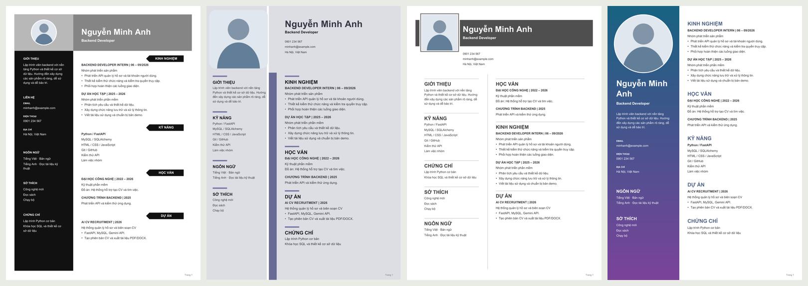

# Tuần 3 — Quản lý CV và xuất tài liệu

## Mục tiêu và chức năng

Xây dựng chức năng tạo CV từ hồ sơ ứng viên, hỗ trợ biên soạn bằng mô hình ngôn ngữ, chỉnh sửa và lưu phiên bản. PDF là đầu ra chính để ứng tuyển; DOCX là định dạng bổ sung phục vụ chỉnh sửa.

- Tạo bản nháp từ hồ sơ đã lưu hoặc sử dụng AI biên soạn nội dung.
- Chỉnh sửa thủ công hoặc yêu cầu AI chỉnh sửa phiên bản được chọn.
- Lưu mỗi lần thay đổi thành một phiên bản độc lập, giữ nguyên các bản trước.
- Quản lý lịch sử theo tài khoản, phân trang 30 phiên bản mỗi lượt.
- Chọn mẫu trình bày và ảnh chân dung tùy theo yêu cầu của mẫu.
- Xem trước PDF, xuất PDF A4 và DOCX từ phiên bản đã lưu.
- Kiểm tra chủ sở hữu trong thao tác đọc, lưu, xem trước và tải tài liệu.

## Tích hợp mô hình ngôn ngữ

Chức năng CV được tích hợp Gemini ở giai đoạn đầu và hiện mặc định sử dụng Ollama local. Cấu hình đang sử dụng:

```dotenv
AI_PROVIDER=ollama
OLLAMA_BASE_URL=http://127.0.0.1:11434
OLLAMA_MODEL=qwen2.5:7b
OLLAMA_TIMEOUT_SECONDS=180
```

Backend gửi dữ kiện nghề nghiệp và yêu cầu biên soạn, kiểm tra đầu ra JSON theo schema trước khi tạo phiên bản. Các trường liên hệ và ảnh không được tự động thêm vào payload. Thông tin liên hệ được nhập trong phần văn bản nghề nghiệp vẫn là một phần của nội dung đó.

Mô hình được hướng dẫn bảo toàn dữ kiện, không tự thêm bằng cấp, kinh nghiệm hoặc thành tích. Đầu ra vẫn cần được người sử dụng kiểm tra. Khi dịch vụ lỗi, quá thời gian hoặc trả dữ liệu sai cấu trúc, hệ thống không lưu một phiên bản AI không hợp lệ.

Gemini có thể được chọn chủ động qua `AI_PROVIDER=gemini`, `GEMINI_API_KEY` và `GEMINI_MODEL`. Ứng dụng không tự chuyển từ Ollama sang dịch vụ đám mây khi có lỗi. Thông tin xác thực được cấu hình riêng trong `.env`.

## Dữ liệu và quyền truy cập

Bảng `cvs` lưu hồ sơ nguồn tại thời điểm tạo và nội dung từng phiên bản. Nội dung gồm document, origin, parent_id, model và design. Thay đổi hồ sơ ứng viên sau đó không sửa CV đã lưu; các phiên bản chỉnh sửa giữ quan hệ với phiên bản trước.

Ảnh chân dung được lưu trong bảng `cv_photos`, cột `data MEDIUMBLOB`, liên kết với tài khoản. Quy trình xử lý:

1. Nhận JPEG, PNG hoặc WebP tĩnh, tối đa 3 MB.
2. Kiểm tra kích thước tối thiểu 64 px, tối đa 16 triệu pixel.
3. Áp dụng hướng EXIF, cắt vuông từ tâm, chuẩn hóa thành JPEG 720×720 và loại metadata.
4. Dùng hash nội dung để tránh lưu trùng trong cùng tài khoản.

Ảnh được đọc qua API có xác thực. CV được xuất trong bộ nhớ, không lưu thành file công khai trong static. Các phản hồi API riêng tư sử dụng `Cache-Control: no-store`.

## Mẫu trình bày

| Mẫu | Đặc điểm | Ảnh chân dung |
| --- | --- | --- |
| Monochrome | Banner xám, cột trái đen, tiêu đề dạng mũi tên | Tùy chọn |
| Lavender | Nền tím nhạt, ảnh bo góc, đường phân chia cột | Bắt buộc |
| Editorial | Banner xám, ảnh vuông, đường kẻ phân nhóm | Tùy chọn |
| Gradient | Cột trái chuyển màu xanh–tím, ảnh tròn lớn | Bắt buộc |

Các mẫu được phát triển theo bộ ảnh tham chiếu trong `docs/references/cv-templates/`. Phông chữ, tỷ lệ cột, vị trí ảnh và thứ tự nhóm được thiết lập riêng cho từng mẫu. Không tự bổ sung điểm kỹ năng hoặc dữ kiện để điền bố cục.

Mã mẫu cũ forest, portrait và minimal được giữ để tương thích dữ liệu. Thumbnail được dựng từ PDF với dữ liệu minh họa. Bản xem trước dùng cùng hàm xuất PDF rồi chuyển trang thành ảnh; thao tác này không lưu phiên bản CV mới.

PDF sử dụng font Unicode, nhúng ảnh và hỗ trợ phân trang. Trên Windows tự nhận Arial; có thể chỉ định TTF qua `CV_FONT_PATH` và `CV_FONT_BOLD_PATH`. DOCX giữ nội dung và ảnh trong bố cục có thể chỉnh sửa, không bảo đảm trùng bố cục PDF và có thể thay đổi theo phần mềm mở tài liệu.



## API

| Phương thức | Endpoint | Chức năng |
| --- | --- | --- |
| GET | `/api/cvs/status` | Trạng thái provider/model |
| GET | `/api/cvs/templates` | Danh sách mẫu và yêu cầu ảnh |
| POST | `/api/cvs/photos` | Tải và chuẩn hóa ảnh |
| GET | `/api/cvs/photos/{id}` | Đọc ảnh thuộc tài khoản |
| GET | `/api/cvs?before_id=...` | Lịch sử phiên bản |
| POST | `/api/cvs/draft` | Tạo bản nháp từ hồ sơ |
| POST | `/api/cvs/generate` | Biên soạn bằng AI |
| POST | `/api/cvs/preview` | Xem trước PDF hoặc ảnh trang |
| GET | `/api/cvs/{id}` | Nội dung phiên bản |
| POST | `/api/cvs/{id}/versions` | Lưu phiên bản chỉnh sửa thủ công |
| POST | `/api/cvs/{id}/revise` | AI chỉnh sửa bản đã lưu |
| GET | `/api/cvs/{id}/export/pdf` | Xuất PDF |
| GET | `/api/cvs/{id}/export/docx` | Xuất DOCX |

API yêu cầu cookie phiên. Thao tác thay đổi dữ liệu sử dụng header `X-Requested-With: cv-app` và kiểm tra Origin. Ảnh hoặc CV không thuộc tài khoản trả 404. Mẫu bắt buộc ảnh nhưng chưa có ảnh hợp lệ trả 422.

## Kiểm thử

Bộ kiểm thử CV bao phủ bản nháp, lưu phiên bản, dữ liệu nguồn, quyền truy cập, lỗi AI, tiếng Việt, nội dung đặc biệt, phân trang, yêu cầu ảnh, chuẩn hóa ảnh và quyền riêng tư.

PDF ngắn và nhiều trang đã được kiểm tra bố cục của bốn mẫu. Kiểm tra tọa độ chữ trên 16 trang thử nghiệm không ghi nhận chữ vượt khổ giấy. Có ca hồi quy kiểm tra phần trang trí tiêu đề Lavender không giao với chữ tiếng Việt.

Ollama local đã được kiểm tra trực tiếp qua luồng tạo và chỉnh sửa CV. DOCX đã kiểm tra cấu trúc, nội dung và ảnh nhúng; chưa xác nhận tính đồng nhất bố cục trên nhiều phần mềm soạn thảo. Kết quả toàn hệ thống được tổng hợp trong [báo cáo tuần 5](week-5-test-report.md).

## Hướng dẫn kiểm tra chức năng

1. Lưu hồ sơ và tạo bản nháp CV.
2. Chỉnh sửa, lưu phiên bản và đối chiếu bản trước.
3. Chọn mẫu có ảnh, tải ảnh và lưu thành bản mới.
4. Kiểm tra xem trước, tải PDF và đối chiếu dữ liệu đã lưu.
5. Sử dụng AI biên soạn/chỉnh sửa và kiểm tra nội dung.
6. Đăng nhập tài khoản khác để kiểm tra tách biệt dữ liệu.

Migration ảnh `database/week-3-photos.sql` được áp dụng sau schema ban đầu và migration tài khoản. Hướng dẫn cài đặt tổng thể nằm trong [README](../README.md).
