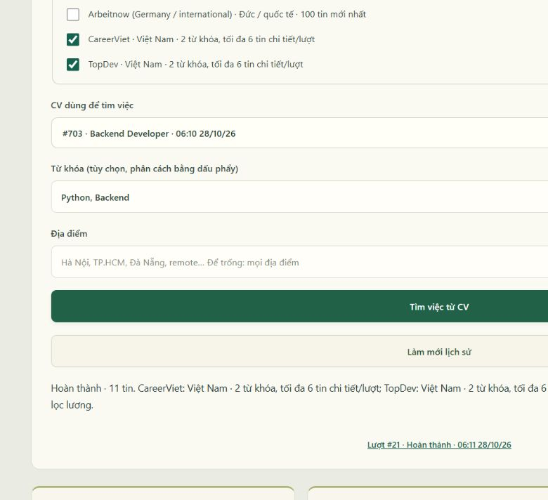
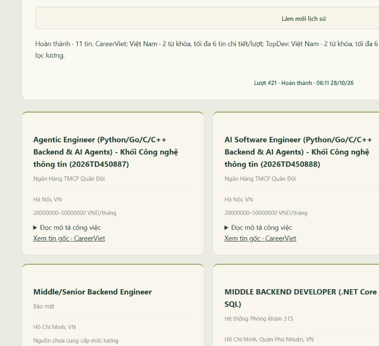

# Tuần 4 — Ollama local và tìm việc Việt Nam

Giai đoạn này triển khai tìm tin qua CareerViet/TopDev, nguồn quốc tế tùy chọn, chuẩn hóa và lưu dữ liệu MySQL, xử lý nền và lịch sử riêng theo tài khoản.

## Tiến độ hiện tại

Đã tích hợp **CareerViet và TopDev**, mặc định chọn hai nguồn Việt Nam. Arbeitnow là nguồn quốc tế tùy chọn. Có hàng đợi MySQL, worker riêng, chọn nguồn, kết quả/lịch sử riêng từng tài khoản. Thu thập đang có giới hạn nhỏ để nghiệm thu ổn định; chưa chấm điểm phù hợp và chưa lọc mức lương.

Ollama là mặc định: `qwen2.5:7b`, `num_ctx=8192`, `num_predict=3072`, temperature 0, timeout 180 giây. CV cũ vẫn đọc được. Không tự fallback lên Gemini khi local lỗi. Đã gọi tạo/sửa CV thật và xuất PDF/DOCX thành công. DOCX vẫn còn nghiệm thu trực quan bằng Word/LibreOffice.

## Khảo sát nguồn phổ biến ở Việt Nam

Thời điểm khảo sát: 27/10/2026.

| Nguồn | Kết quả kiểm tra trực tiếp | Tích hợp |
| --- | --- | --- |
| CareerViet | Trang tìm kiếm và tin chi tiết trả 200; có JobPosting JSON-LD chứa nội dung, công ty, địa điểm, lương và hạn tuyển | Đã bật adapter HTML công khai |
| TopDev | `/jobs/search?keyword=...` và `/detail-jobs/...` trả 200; có JobPosting JSON-LD | Đã bật adapter HTML công khai; không hiển thị lương vì giao diện nguồn yêu cầu đăng nhập |
| TopCV | Trang công khai có trong công cụ tìm kiếm; HTTP trực tiếp từ máy trả 403 | Chưa bật; không vượt chặn, không tuyên bố đã tích hợp |
| VietnamWorks | `/python-kw` trả 200 nhưng HTML/Next data kiểm tra chưa có danh sách tin đủ nội dung | Chưa bật adapter; còn xác minh đường lấy tin công khai ổn định |
| JobsGO | Trang tìm Python trả 403; điều khoản có giới hạn thu thập tự động | Không chọn làm nguồn mặc định |
| ITJobs | Swagger công khai nhưng endpoint Jobs trả 401; trang HTML đọc được | Nguồn khảo sát bổ sung, chưa tích hợp |
| Arbeitnow | Feed JSON công khai trả 100 tin; chủ yếu Đức/quốc tế | Giữ làm nguồn tùy chọn, không tự chọn khi đã có nguồn Việt Nam |

Tham chiếu chính thức: [CareerViet Python](https://careerviet.vn/viec-lam/python-k-vi.html), [CareerViet robots](https://careerviet.vn/robots.txt), [TopDev tìm Python](https://topdev.vn/jobs/search?keyword=python), [TopDev robots](https://topdev.vn/robots.txt), [TopDev thỏa thuận](https://topdev.vn/term-of-services), [TopCV](https://www.topcv.vn/tim-viec-lam-python), [VietnamWorks](https://www.vietnamworks.com/python-kw), [Ollama Chat API](https://docs.ollama.com/api/chat), [Arbeitnow API](https://www.arbeitnow.com/api/job-board-api).

Đây là triển khai đồ án local với số lượng nhỏ, giữ tên nguồn và link gốc. Robots và khả năng đọc HTTP không đồng nghĩa giấy phép tái xuất bản thương mại; không công bố lại toàn bộ nội dung nguồn như một dịch vụ tuyển dụng riêng.

## Cách thu thập và giới hạn

- Mỗi nguồn Việt Nam dùng tối đa **hai từ khóa đầu**, đọc trang đầu của từng từ khóa và tối đa **6 tin chi tiết mỗi lượt**. Không quét toàn bộ website.
- Chỉ truy cập HTTPS trên domain cố định, đường dẫn chi tiết đã kiểm tra. Chặn URL tài khoản/ứng tuyển, domain khác, cổng lạ, đường dẫn mã hóa và redirect. Không lấy URL nguồn tùy ý từ trình duyệt.
- Đọc robots trước khi thu thập; dừng khi bị cấm hoặc không đọc được robots. Khoảng cách tối thiểu 1,2 giây giữa các request trong tiến trình; cache trang 10 phút, robots 1 giờ. Timeout 15 giây/request, ngân sách khoảng 90 giây/nguồn, trang tối đa 4 MB.
- Chuẩn hóa JobPosting JSON-LD thành văn bản thuần, loại HTML/script; lấy tên công ty, địa điểm, kỹ năng, ngày đăng/hạn khi có. Bỏ tin đã hết hạn. Không tự bịa trường thiếu; không coi lương thiếu là 0.
- CareerViet hiện lấy mức lương công khai có đơn vị. TopDev ghi rõ cần đăng nhập xem lương, không dùng trường lương chỉ có trong metadata để mở phần bị ẩn trên giao diện nguồn.
- Loại trùng URL sau khi bỏ query/fragment; lưu hash. Chỉ lọc OR từ khóa theo ranh giới từ, chưa phải đánh giá phù hợp.
- Địa điểm bỏ dấu và chuẩn hóa các cách viết Hà Nội/Hanoi, TP.HCM/Hồ Chí Minh/Sài Gòn, Đà Nẵng/Da Nang. Remote chỉ dựa trên cờ rõ ràng của nguồn, không suy diễn từ vài từ trong mô tả.
- Nếu một số trang/tin lỗi, vẫn giữ dữ liệu đọc được và ghi cảnh báo. Nếu một nguồn lỗi, tiếp tục nguồn còn lại, đánh dấu lượt partial. Không có dữ liệu đọc được thì thông báo thất bại thay vì tạo tin giả. Trường hợp trang không có link tin nhưng chưa xác nhận được cấu trúc rỗng cũng báo lỗi để tránh che việc nguồn thay giao diện.

## Hàng đợi và quyền truy cập

POST tìm việc trả 202 và lưu snapshot hồ sơ/CV, từ khóa, địa điểm, nguồn chọn. Mỗi tài khoản tối đa một lượt queued/running, giãn cách 30 giây giữa hai lượt. Không cho chọn CV của người khác, nguồn chưa hỗ trợ hoặc danh sách nguồn rỗng.

Worker claim lượt bằng `FOR UPDATE SKIP LOCKED`, xử lý ngoài yêu cầu web, đổi trạng thái queued → running → completed/partial/failed. Running quá 10 phút chuyển failed khi worker chạy lại. Job lưu trong catalog, snapshot kết quả theo từng lượt không bị thay đổi khi hồ sơ hoặc tin thay đổi sau đó. UI thăm dò 3 giây, lịch sử phân trang 20 lượt, API kiểm tra chủ sở hữu.

## Cài đặt và chạy

Với database mới: schema.sql → week-2.sql → week-3-photos.sql → week-4.sql → **week-4-vietnam.sql**. Migration Việt Nam có thể chạy lại, giữ trạng thái bật/tắt nguồn đã tồn tại.

Mở Ollama với model `qwen2.5:7b`. `.env`: AI_PROVIDER=ollama, OLLAMA_BASE_URL=http://127.0.0.1:11434, OLLAMA_MODEL=qwen2.5:7b, OLLAMA_TIMEOUT_SECONDS=180. Ollama không cần API key. Nội dung quá dài bị từ chối theo ngân sách byte bảo thủ (không phải đếm tokenizer chính xác); đầu ra thiếu/sai/trống hoặc hết token không được lưu. Nội dung AI cần được kiểm tra trước khi sử dụng.

Chạy **run.bat** và **run-worker.bat** ở hai terminal. Worker không mở cổng HTTP. Khi chưa chạy worker, lượt ở trạng thái chờ; worker khởi động sẽ tiếp tục. Ctrl+C để dừng; `run-worker.bat --once` xử lý tối đa một lượt rồi thoát.

Đăng nhập → lưu hồ sơ → tạo CV → phần **Tìm việc từ CV của bạn** → chọn CareerViet/TopDev, tùy chọn từ khóa/địa điểm → tìm việc. Để trống địa điểm để tìm toàn nguồn; để trống từ khóa để lấy vị trí/kỹ năng CV. Bấm **Làm mới lịch sử** sau khi tạo CV mới để cập nhật danh sách 30 CV gần nhất.

API: GET `/api/searches/sources`; POST `/api/searches` với cv_id, keywords/location tùy chọn và source_ids tùy chọn; GET `/api/searches?before_id=...`; GET `/api/searches/{id}`. Bỏ source_ids thì ưu tiên nguồn Việt Nam đã bật; truyền source_ids thì chỉ dùng các nguồn đó.

## Kiểm thử

- **40/40 kiểm thử qua trên MySQL và SQLite**, gồm toàn bộ tài khoản/CV trước đó, Ollama, chọn nguồn, ưu tiên Việt Nam, snapshot/quyền truy cập, parser JSON-LD, robots/redirect/cache, chuẩn hóa địa điểm, tin hết hạn, lương, loại trùng và xử lý partial.
- Gọi nguồn thật với Python/Backend: đọc được 6 tin CareerViet và 6 tin TopDev, không có cảnh báo trong lượt thử; lọc Hà Nội còn 3 tin CareerViet và 1 tin TopDev.
- Trình duyệt kiểm tra mặc định chọn hai nguồn Việt Nam, nguồn quốc tế chưa chọn. Luồng xử lý nền và mở lại lịch sử đã được kiểm tra với dữ liệu tuyển dụng thực tế.
- Nghiệm thu giao diện với từ khóa `Python, Backend`, không giới hạn địa điểm: worker hoàn thành với **11 tin** (6 CareerViet, 5 TopDev sau lọc), không báo lỗi nguồn. Reload và mở lại lượt vẫn đọc đủ kết quả.
- Dữ liệu ứng viên kiểm thử được mô phỏng và tách biệt với dữ liệu sử dụng thực tế.

## Còn lại

TopCV/VietnamWorks chưa tích hợp. Chưa có hủy lượt hoặc UI quản trị nguồn; chưa kiểm tra tải nhiều worker/người dùng trên quy mô lớn. Cần mở rộng phân trang/phạm vi và đo độ bao phủ từ khóa trên tập hồ sơ mẫu. Chấm điểm, giải thích và xếp hạng thuộc tuần 5. DOCX là đầu ra bổ sung; PDF là định dạng CV chính.

## Tài liệu liên quan

Mốc phiên bản giai đoạn này là `week-4`. Hướng dẫn cài đặt và migration nằm trong [README](../README.md). Chức năng đánh giá và xếp hạng được trình bày trong [tài liệu tuần 5](week-5.md).
