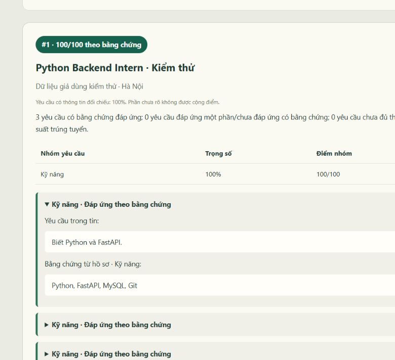

# Báo cáo kiểm thử tuần 5

Ngày báo cáo: **28/10/2026**, múi giờ Asia/Bangkok.

**Kết luận:** các tình huống chức năng được kiểm tra đều qua. Chưa có cơ sở kết luận độ chính xác AI đạt 100%, hoặc đã sẵn sàng triển khai quy mô lớn.

## 1 Phạm vi và cách kiểm tra

Đối tượng kiểm thử là các chức năng thuộc phiên bản `week-5`. Đã phát hiện và bổ sung kiểm soát bằng chứng kỹ năng mềm trong đợt lập báo cáo; các số liệu tự động cuối được chạy lại sau sửa. Dữ liệu ứng viên dùng trong kiểm thử là giả; không dùng hồ sơ thật của người dùng.

- Chạy lại cùng 62 phương thức kiểm thử trên MySQL thật và SQLite trong bộ nhớ.
- Trong đó 22 phương thức kiểm tra trực tiếp tuần 5; 40 phương thức kiểm tra hồi quy tài khoản, CV, nguồn và tìm việc.
- Các kiểm thử lỗi AI và API/worker dùng đầu ra mô phỏng để kiểm tra nhánh xử lý. Chúng không đo khả năng hiểu ngôn ngữ của mô hình.
- Gọi Ollama thật với bốn tình huống có kỳ vọng xác định và một tin CareerViet công khai đã lưu. Chưa có điểm chuẩn do chuyên gia chấm cho tin CareerViet.
- Kiểm thử giao diện gồm theo dõi tiến độ, tải lại trang, dừng lượt xử lý và đối chiếu lịch sử; kết quả được trình bày riêng với các ca tự động.

## 2 Kết quả tự động

| Môi trường | Số ca | Qua | Thất bại | Lỗi chạy | Bỏ qua | Thời gian |
| --- | ---: | ---: | ---: | ---: | ---: | ---: |
| mysql | 62 | 62 | 0 | 0 | 0 | 9.344 giây |
| sqlite | 62 | 62 | 0 | 0 | 0 | 8.859 giây |

**62 ca riêng biệt, chạy trên hai môi trường là 124 lượt thực thi; không phải 124 ca khác nhau.** Thời gian trên chỉ là một lần đo local, không phải kiểm thử tải.

| Nhóm | Số phương thức | Phạm vi |
| --- | ---: | --- |
| `test_accounts.AccountTests` | 7 | Hồi quy tuần trước |
| `test_cvs.CVTests` | 18 | Hồi quy tuần trước |
| `test_evaluations.EvaluationAPITests` | 11 | Tuần 5 |
| `test_evaluations.ScoringTests` | 11 | Tuần 5 |
| `test_vietnam_sources.VietnamParserTests` | 5 | Hồi quy tuần trước |
| `test_vietnam_sources.VietnamSearchTests` | 2 | Hồi quy tuần trước |
| `test_week4.OllamaTests` | 4 | Hồi quy tuần trước |
| `test_week4.SearchTests` | 4 | Hồi quy tuần trước |

## 3 Ma trận 22 ca trực tiếp tuần 5

| STT | Nội dung | Kỳ vọng đã kiểm tra | MySQL / SQLite |
| ---: | --- | --- | --- |
| 1 | Đăng nhập, quyền sở hữu, chống yêu cầu khác nguồn | Khách 401; tài khoản khác không đọc/tạo/hủy kết quả của chủ sở hữu; thiếu header bảo vệ khi tạo trả 403. | passed / passed |
| 2 | Dừng khi đang có request AI | Kết quả đến sau hủy không được lưu/ghi đè; các tin chưa xong có score null. | passed / passed |
| 3 | Thời gian MySQL và UTC | created_at gần UTC ứng dụng; chênh NOW/UTC của session MySQL bằng 0. | passed / passed |
| 4 | Điều kiện bắt đầu đánh giá | Lượt tìm chưa xong hoặc không có tin → 409, không tạo batch sai. | passed / passed |
| 5 | Phân trang lịch sử | 21 lượt: trang đầu 20, trang sau đúng lượt còn lại; quyền chủ sở hữu kiểm tra ở ca riêng. | passed / passed |
| 6 | Ollama không sẵn sàng | Chỉ gọi một lần khi xác định dịch vụ offline; các tin còn lại thất bại rõ ràng, không bịa điểm. | passed / passed |
| 7 | Một phần lỗi, một phần thiếu thông tin | Batch partial; từng tin failed/insufficient riêng; không ép null thành 0. | passed / passed |
| 8 | Khôi phục worker gián đoạn | Heartbeat quá hạn được phục hồi; giữ phần đã hoàn thành, chỉ chạy tin còn dở. | passed / passed |
| 9 | Xếp hạng khi đồng điểm | Cùng điểm, độ bao phủ 100% đứng trước 50%. | passed / passed |
| 10 | Giới hạn thử lại | Hai lần gián đoạn → dừng retry, trạng thái failed, không lặp vô hạn. | passed / passed |
| 11 | Snapshot, xếp hạng và giữ lịch sử | Dùng dữ liệu lúc tìm; điểm 100 đứng trước 50; lượt mới không sửa kết quả cũ; không tạo trùng khi đang active. | passed / passed |
| 12 | Không suy diễn thiếu năng lực | Chưa thấy Java/không biết tổng năm → unknown; khai báo rõ tổng 1 năm so với yêu cầu 3 năm có thể xác định chưa đạt. | passed / passed |
| 13 | JSON lỗi, hết token, timeout, offline, đầu vào dài | Không tạo điểm giả; trả lỗi có phân loại 422/502/503/504. | passed / passed |
| 14 | Bằng chứng kỹ năng cơ bản trực tiếp | Có thể tìm lại Git trong trường kỹ năng; không lấy tên dự án, phủ định hoặc suy ra trình độ chuyên sâu. | passed / passed |
| 15 | Trích dẫn giả và tiêu chí lặp | Bằng chứng sai → unknown; yêu cầu không có trong tin hoặc Pythonista/Python → từ chối; đoạn lặp không tăng trọng số. | passed / passed |
| 16 | Payload Ollama local | JSON schema, ngữ cảnh 8192, URL localhost; họ tên/email/điện thoại giả không có trong payload. | passed / passed |
| 17 | Nhóm không được yêu cầu và thiếu bằng chứng | Chỉ yêu cầu kỹ năng → trọng số 100%; không có yêu cầu/đều unknown → score null. | passed / passed |
| 18 | Yêu cầu nhiều công cụ | Chỉ có Git không được coi là đáp ứng đầy đủ danh sách ROS/Linux/Docker/Git đã nhận diện. | passed / passed |
| 19 | Loại yếu tố nhạy cảm đã nhận diện | Không đưa yêu cầu giới tính/tuổi trong mẫu vào điểm; kỹ năng vẫn được đối chiếu. | passed / passed |
| 20 | Bằng chứng kỹ năng mềm đúng loại | Danh sách Python/FastAPI/MySQL/Git không chứng minh tư duy hệ thống/làm việc nhóm; có bằng chứng một phần hoặc đầy đủ được phân loại riêng. | passed / passed |
| 21 | Bằng cấp chưa hoàn tất | Sinh viên năm cuối không được đáp ứng đầy đủ điều kiện đã có bằng; tin cho phép sinh viên vẫn được đối chiếu đúng. | passed / passed |
| 22 | Trọng số và độ bao phủ | Kỹ năng đủ, kinh nghiệm partial, học vấn unknown → 65 điểm, bao phủ 80%, cận trên 85. | passed / passed |

## 4 Kết quả Ollama thật trước sửa lỗi mới

Model: **qwen2.5:7b**, ngữ cảnh **8192 token**, đầu ra tối đa 3072 token, temperature 0. Kết quả là của toàn pipeline Ollama + kiểm tra trích dẫn/quy tắc backend, không phải chỉ điểm do model tự đưa ra.

Hồ sơ giả chung: Python, FastAPI, MySQL, Git; 1 năm phát triển API bằng Python; sinh viên năm cuối CNTT; một dự án FastAPI/MySQL. Không khai báo Docker, Kubernetes, Java/Spring Boot hay đã tốt nghiệp.

| Tình huống | Trạng thái pipeline | Điểm | Bao phủ thông tin | Thời gian thực đo |
| --- | --- | ---: | ---: | ---: |
| Python Backend Intern | completed | 100.0/100 | 100.0% | 29.141 giây |
| Python Infrastructure | completed | 33.33/100 | 33.33% | 15.922 giây |
| Tin chỉ có quyền lợi | insufficient | Không tạo điểm | 0.0% | 0.953 giây |
| Senior Java Developer | completed | 10.0/100 | 20.0% | 23.406 giây |
| Kỹ Sư Robotic | completed | 15.0/100 | 20.0% | 91.266 giây |

Diễn giải bốn tình huống kiểm soát:

- Python cơ bản: cả ba yêu cầu Python/FastAPI, MySQL và Git có trích dẫn trực tiếp trong trường kỹ năng. Tin chỉ yêu cầu nhóm kỹ năng nên trọng số nhóm được chuẩn hóa thành 100%.
- Python Infrastructure: chỉ Python có bằng chứng; Docker và Kubernetes là unknown. Kết quả kỳ vọng là 1/3 điểm kỹ năng, không khẳng định ứng viên không có hai kỹ năng đó.
- Tin chỉ có quyền lợi: không có yêu cầu để tính điểm; null/insufficient là kết quả đúng, không phải lỗi hoặc 0 điểm.
- Senior Java: không cộng điểm đầy đủ cho Java/Spring Boot, không suy ra tổng kinh nghiệm từ một vai trò, không coi sinh viên năm cuối đã có bằng. 10 điểm nếu AI trích được bằng chứng học vấn partial; đó là 20% × 0,5. Độ bao phủ 20% cho thấy kết quả còn thiếu nhiều thông tin.

Với tin CareerViet thật, điểm và trích dẫn cần người chấm kiểm tra; chỉ dùng để xác nhận pipeline đọc được tin thực tế. Không đưa ca này vào tỷ lệ chính xác của mô hình. Bảng này ghi một lượt cho mỗi tình huống trước bản sửa mới; riêng tin CareerViet được gọi lại sau sửa ở mục 5a. Chưa đo độ ổn định qua nhiều lần lặp hoặc p95 khi tải cao.

## 5 Lỗi đã phát hiện và biện pháp kiểm soát

| Vấn đề đã gặp khi phát triển | Tác động | Kiểm soát hiện tại |
| --- | --- | --- |
| Danh sách công nghệ bị coi là bằng chứng kỹ năng mềm (mới phát hiện trong đợt báo cáo) | Tăng sai điểm ở tin thật | Thêm ca hồi quy và kiểm tra loại bằng chứng; xem đối chiếu trước/sau dưới đây |
| Session MySQL +07:00 trong khi ứng dụng so sánh UTC | Cooldown 30 giây và thời gian hiển thị bị tính sai | Đặt session UTC, batch.created_at dùng TIMESTAMP; kiểm thử chênh lệch và UI đánh giá lại đã qua |
| Model lặp cùng yêu cầu | Có thể tăng trọng lượng một yêu cầu | Gộp đoạn lặp; phân loại mâu thuẫn thành unknown |
| Coi sinh viên năm cuối đã có bằng | Cộng điểm học vấn quá mức | Quy tắc nhận diện đang học, không cho nhận matched đầy đủ trong mẫu nhận diện |
| Chỉ có Git nhưng nhận matched cả danh sách nhiều công cụ | Cộng điểm kỹ năng quá mức | Hạ phân loại khi bằng chứng không phủ các công nghệ nhận diện trong nhóm yêu cầu |
| Bỏ sót Git đã ghi trong kỹ năng | Giảm điểm dù dữ liệu có bằng chứng | Tìm lại một số kỹ năng cơ bản trực tiếp trong trường kỹ năng, không suy từ tên dự án hoặc phủ định |
| Trích dẫn yêu cầu/bằng chứng không tồn tại | Có thể tạo điểm không có căn cứ | Yêu cầu sai → failed không điểm; bằng chứng sai → unknown |

Các biện pháp trên là kiểm soát có kiểm thử cho mẫu cụ thể, không phải bảo đảm loại bỏ mọi biến thể lỗi ngôn ngữ.

## 5a Đối chiếu lỗi mới trước và sau sửa

Ca CareerViet ở bảng trên đã bộc lộ lỗi thật: AI dùng danh sách Python/FastAPI/MySQL/Git làm bằng chứng cho tư duy hệ thống, giải quyết vấn đề, làm việc nhóm và độc lập. Đoạn trích tồn tại nhưng không chứng minh các kỹ năng này. Do đó không coi ca thực tế ban đầu là đánh giá chất lượng đạt.

Đã thêm kiểm thử hồi quy yêu cầu các bằng chứng đó phải chuyển unknown. Quy tắc mới nhận diện một số nhóm kỹ năng mềm, không coi tên công nghệ là bằng chứng đủ; bằng chứng chỉ phủ một phần nhóm thì không nhận matched đầy đủ.

| Phép kiểm tra | Điểm | Bao phủ | Ý nghĩa |
| --- | ---: | ---: | --- |
| Trước sửa, tin CareerViet thật | 15.0 | 20.0% | Có cộng nhầm hai tiêu chí kỹ năng mềm |
| Chạy lại chính đầu ra gốc đó bằng backend đã sửa | 5.0 | 10.0% | Hai tiêu chí không có bằng chứng đúng loại đã về unknown |
| Gọi Ollama mới sau sửa | 5.0 | 10.0% | completed; 93.938 giây |

Chạy lại cùng đầu ra gốc giúp tách tác động của bản sửa khỏi biến động model. Lượt gọi mới có thể trích tập tiêu chí khác; không yêu cầu điểm luôn trùng tuyệt đối. Việc giảm điểm trong ca này chỉ xác nhận loại bỏ phần cộng sai, không biến điểm còn lại thành điểm chuẩn do người chấm xác nhận. Quy tắc vẫn có thể bỏ sót cách diễn đạt tương đương và cần hiệu chỉnh ở tuần 6.

## 6 Kiểm thử tích hợp giao diện

- UI → queue → worker → Ollama → MySQL: ba tin giả cho 100 điểm, 33,33 điểm và insufficient; 3/3 tin đã xử lý, không có lỗi dịch vụ trong lượt đó.
- Mở được đoạn yêu cầu và bằng chứng trong hồ sơ. Reload vẫn đọc được lượt đã lưu.
- Tạo lượt mới và dừng; lượt trước vẫn giữ nguyên kết quả. Giới hạn một lượt active và cooldown được kiểm tra.
- Tài khoản và tin tuyển dụng mô phỏng được cô lập trong quá trình kiểm thử; dữ liệu được loại bỏ sau kiểm tra.



## 7 Các giới hạn và phần chưa được chứng minh

- Chưa có tập dữ liệu nhiều hồ sơ/tin do người chấm độc lập, chưa đo precision/recall, độ đúng ngữ nghĩa hoặc chất lượng thứ hạng.
- Chưa kiểm tra tính công bằng theo nhóm, độ ổn định khi chạy lặp nhiều lần, kiểm thử prompt injection chuyên biệt hoặc kiểm thử bảo mật toàn diện.
- Tối đa 12 tiêu chí/tin; trích dẫn đúng vị trí không đồng nghĩa phân loại đúng ý nghĩa. Danh sách công nghệ và quy tắc không bao phủ mọi ngành hoặc điều kiện AND/OR phức tạp.
- Nội dung quá ngân sách 12.000 byte UTF-8 bị từ chối có thông báo; chưa có chia đoạn. Đây là giới hạn byte bảo thủ cho ngữ cảnh, không phải phép đếm tokenizer chính xác.
- Worker đánh giá tuần tự, chưa đo tải nhiều người dùng/nhiều worker, thời gian phục hồi thực tế sau khi buộc dừng tiến trình hoặc hiệu năng trên máy khác.
- Các lỗi mạng, timeout và gián đoạn worker trong autotest được mô phỏng; không chủ động làm hỏng MySQL hay tắt Ollama của người dùng để thử.
- Giữ nguyên giới hạn nguồn tuần 4: CareerViet/TopDev đang có adapter; TopCV/VietnamWorks chưa tích hợp; tối đa 6 tin chi tiết/nguồn Việt Nam/lượt tìm.

## 8 Kết luận và trạng thái mã nguồn

**Chức năng tuần 5:** các tình huống đã kiểm tra đạt yêu cầu: đối chiếu bằng chứng, chấm điểm có kiểm soát, xếp hạng, lưu lịch sử, phân quyền, tiến độ, dừng và xử lý lỗi. Các ca tự động sau điều chỉnh đều đạt kết quả mong đợi.

**Chất lượng AI:** chưa đủ cơ sở công bố tỷ lệ chính xác hoặc coi điểm là kết quả tuyển dụng. Các tình huống kiểm soát nhỏ hữu ích để xác nhận hành vi, không thay thế đánh giá trên tập mẫu. Tuần 6 nên ưu tiên bộ hồ sơ/tin có người chấm, đo sai khác và hiệu chỉnh rubric trước khi tối ưu tốc độ.

Mã nguồn, migration và kết quả kiểm thử được lưu cùng phiên bản `week-5`. Dấu vết kiểm thử gồm mã băm của các module và kết quả từng ca trong tệp JSON.

## 9 Tái hiện và hồ sơ kiểm thử

```powershell
.\.venv\Scripts\python.exe -m unittest discover -s tests -v
$env:TEST_MYSQL='1'
.\.venv\Scripts\python.exe -m unittest discover -s tests -v
Remove-Item Env:TEST_MYSQL
node --check static/app.js
git diff --check
```

MySQL cần đã áp dụng migration tuần 5. Test tích hợp dùng giao dịch/savepoint và rollback dữ liệu giả. Các request AI live dùng hồ sơ giả, không tạo tài khoản hay phiên đánh giá mới trong database.

[Kết quả từng ca, thời gian và hash mã nguồn ở dạng JSON](week-5-test-results.json). Tệp JSON tổng hợp định danh ca kiểm thử, thời gian, số liệu kết quả và mã băm module. Dữ liệu nguồn và đầu ra mô hình chi tiết được tách khỏi tài liệu công khai.
